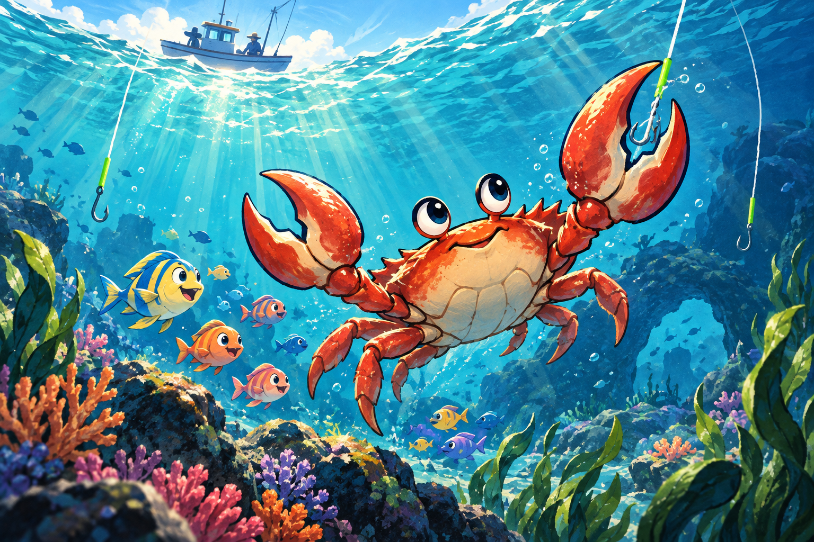

# Snap!

海のカニが釣り糸を切って、魚を守るGame Boy Color用アクションです。
ふわっと泳いで、緑の糸をハサミでパチン！
朝・昼・夕方を駆け抜ける60秒チャレンジ。練習モードもあります。

[最新バージョンをダウンロード](https://github.com/machitomo/snap-releases/releases/latest)

ROM、アート、配布ZIP、Web版ZIPをReleasesで配布しています。

| ボタン | 操作 |
| --- | --- |
| 十字キー | 左右に泳ぐ・下で潜る |
| A | 両手のハサミで緑の糸を切る |
| B | 押すたびにふわっと浮上 |
| START | 開始・ポーズ・再挑戦 |
| SELECT | タイトルで練習モード・結果からタイトルへ |

Web版の操作は、←→で泳ぐ・↓で潜る・Xでハサミ・Z連打で浮上。
Enterで開始・ポーズ、Shiftで練習モードを選びます。
